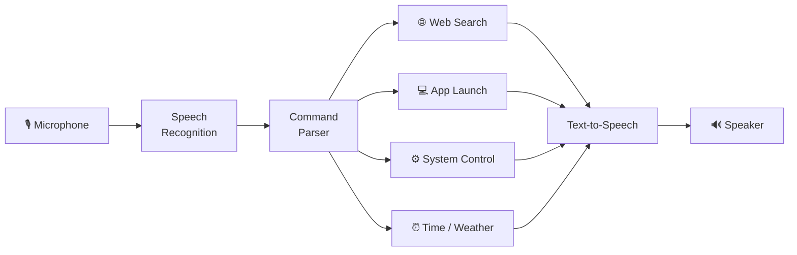

<div align="center">

# 🤖 Scarlett — Virtual Assistant

### Voice-controlled AI assistant in Python


</div>

Scarlett is a voice-controlled **virtual assistant** that takes natural-language
spoken commands and responds via speech. Built in Python with speech-recognition
and text-to-speech libraries.

## 📰 Publication

> **Scarlett: Virtual Assistant and Browlett Browser**

## 🏗️ How it works



## ✨ Capabilities

- Web search and read top results aloud
- Launch applications
- Tell time, date, weather
- Open websites
- System control (volume, shutdown, etc.)
- Conversational responses

## 🚀 Quick start

```bash
pip install SpeechRecognition pyttsx3 pyaudio wikipedia
python scarlett.py
```

Say "Hello Scarlett" to wake it.

## 📜 License
MIT
